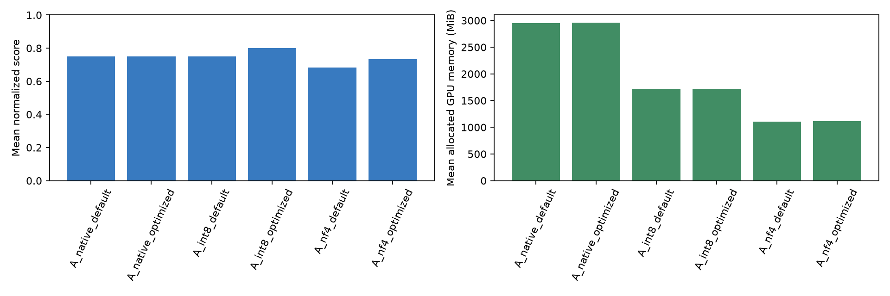
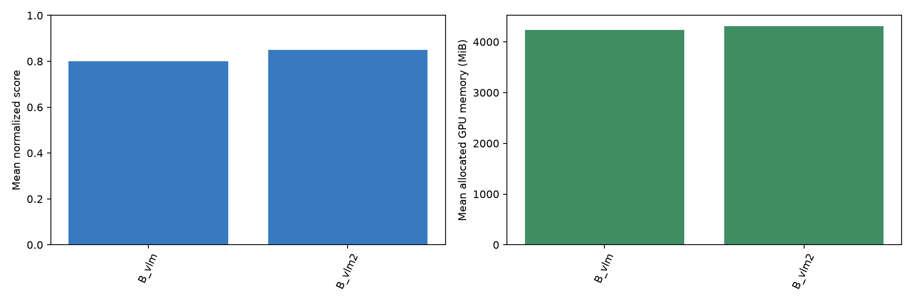
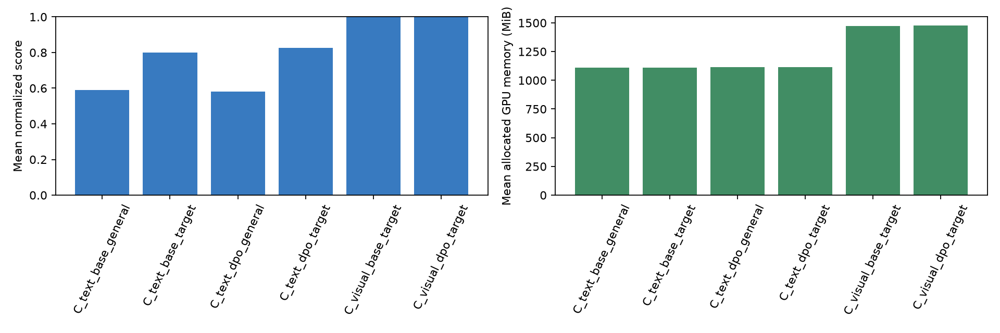
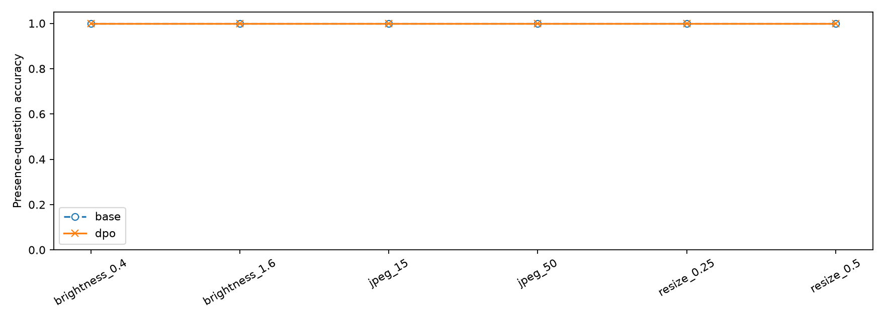
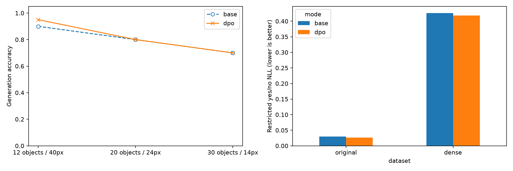

# MMIP - Week 7

本專案包含 `main.ipynb`，依序完成 Quiz 1～Quiz 3（作業 A / B / C，含進階題）。Notebook 保留資料、模型、執行及簡短分析；完整實驗報告整理於本 README，編排參照 Week 5。

## 1. 專案結構

```text
.
├── main.ipynb          # 依章節分開的資料、函式與實驗
├── requirements.txt    # 本次環境套件版本
├── README.md           # 實驗報告
├── data/               # 自訂題目、偏好資料、合成影像
└── outputs/            # 逐題紀錄、CSV、圖表、adapter、環境與版本
```

## 2. 環境安裝（NVIDIA RTX 3060 / CUDA）

使用 Python 3.11；先安裝相容驅動的 CUDA PyTorch，再安裝其餘套件。目前實測環境為 `MMIP-w7`、RTX 3060 12GB、PyTorch 2.14.1+cu126、Transformers 5.22.2、TRL 1.17.1、PEFT 0.21.2。完整清單見 `outputs/environment.txt`。

```bash
python -m pip install torch --index-url https://download.pytorch.org/whl/cu126
python -m pip install -r requirements.txt
```

由 week7 啟動 Notebook，依序執行。已有完整評估會沿用快取；改變資料或設定時請另存 run_id，DPO 可用 `run_suffix="v2"`。既有 adapter 的完成標記會直接續用；重新訓練應另存輸出路徑。每次只載入一個模型。

## 3. 使用模型與資料集

| 用途 | 模型 | 延伸關係 |
|---|---|---|
| A / C 文字 | Qwen/Qwen2.5-1.5B-Instruct | A 基座延伸文字 DPO |
| B / C 視覺 | Qwen/Qwen2-VL-2B-Instruct | B 基座延伸視覺 DPO |
| B 第二模型 | HuggingFaceTB/SmolVLM2-2.2B-Instruct | 同圖、同問題比較 |

三者模型卡皆標示 Apache-2.0。模型 commit 存於 `outputs/model_revisions.json`。

| 資料 | 數量 | 說明 |
|---|---:|---|
| A Instruction Benchmark | 20 test + 5 dev | 格式、推理、擷取、語言、知識各4題 |
| B 視覺 Benchmark | 20 test | 形狀、計數、顏色、OCR、空間關係各4題 |
| C 文字偏好 | 120 train + 20 dev + 40 test | 依據提供資料回答，資訊不足輸出UNKNOWN |
| C 無關通用 Benchmark | 100 test | 運算、排序、JSON、字串、單位、邏輯、數列等 |
| C 視覺偏好 | 120 train + 20 dev + 30 test | 圖中是否存在指定幾何形狀 |
| 補充困難測試 | 60 test | 密集小物件，3種難度各20題，yes/no各半 |

全部為自訂資料；偏好依真值程式生成，不宣稱人工RLHF標註。視覺為自製合成幾何圖，非自然照片。原始圖片依hash隔離分割；補充測試沒有回流訓練。

## 4. 作業項目對照

| Quiz | 項目 | Notebook 章節 |
|---|---|---|
| 1 / A | 開源LLM部署、20題Benchmark | 1.1～1.3 |
| 1 / A | 六種課堂提示技巧與dev選擇 | 1.4 |
| 1 / A | 固定Prompt量化、平均GPU顯存、最佳Prompt＋低精度 | 1.5～1.6 |
| 2 / B | 兩個VLM部署、20題同Prompt比較 | 2.1～2.3 |
| 1 / 2 | 商用模型與量化評分對照 | 2.4 |
| 3 / C 基礎 | ≥100偏好、另外100通用題、文字DPO前後比較 | 3.1～3.4 |
| 3 / C 進階 | ≥100影像偏好、VLM DPO、影像劣化 | 3.5～3.8 |
| 3 / 補充 | 天花板診斷、困難題、答案機率與交叉熵 | 3.9～3.11 |

## 5. 實驗結果

seed=42、batch=1、貪婪解碼、max_new_tokens=96。A/B各條件重複3次作時間/顯存統計，品質仍以20個獨立題目為單位。C固定NF4比較adapter前後。

### Quiz 1：LLM 提示工程、量化與GPU顯存

Score為各題0～1分等權平均，混合exact match、JSON、數值與事實覆蓋率，不等同所有題型統一的accuracy。

| 精度 | Prompt | Score | 平均顯存 MiB | 峰值 MiB | 秒/題 |
| --- | --- | --- | --- | --- | --- |
| 原始 BF16 | 預設 | 0.7500 | 2954.3872 | 2959.2764 | 0.3449 |
| 原始 BF16 | Emotional | 0.7500 | 2954.8527 | 2960.7983 | 0.2494 |
| INT8 | 預設 | 0.7500 | 1712.4667 | 1740.1914 | 1.4627 |
| INT8 | Emotional | 0.8000 | 1713.4324 | 1743.8027 | 1.6496 |
| NF4 | 預設 | 0.6833 | 1109.6963 | 1115.7627 | 0.2581 |
| NF4 | Emotional | 0.7333 | 1111.2266 | 1141.4341 | 0.4633 |

課堂提示技巧在原始BF16精度的比較：

| 技巧 | Test Score |
| --- | --- |
| 中文 Zero-shot | 0.7500 |
| CoT | 0.7500 |
| Emotional Stimuli | 0.7500 |
| Few-Shot | 0.7500 |
| 英文 | 0.7333 |
| XML | 0.7667 |
| Markdown | 0.6667 |

#### 實驗結果分析

- dev選出Emotional Stimuli；原始精度test仍為0.7500，未優於原提示。XML的test為0.7667，但沒有看test後重新選提示。
- INT8＋Emotional為0.8000；NF4＋Emotional為0.7333，平均allocated由約2954 MiB降至1111 MiB，節省約62%。
- PyTorch allocated以50ms採樣取平均，peak另用計數器；NVML總顯存含其他程序。延遲也受回答長度影響，不能只憑單次數字推論模型架構快慢。
- 嚴格JSON會將額外Markdown圍欄判失敗；H₂O和H2O語意相同但字面不同，須配合語意評審。



### Quiz 2：兩個VLM的視覺理解

同一張336×336原圖、相同英文問題、兩模型皆明訂BF16非量化權重。各使用官方processor；SmolVLM停用額外切圖，內部影像token數仍不同。SmolVLM原config為float32，不將BF16誤稱其預設精度。

| VLM | 嚴格 Accuracy | 內容 /4 | 格式 /4 | 平均顯存 MiB | 秒/題 |
| --- | --- | --- | --- | --- | --- |
| Qwen2-VL-2B | 0.8000 | 3.8000 | 3.7000 | 4231.5893 | 0.2347 |
| SmolVLM2-2.2B | 0.8500 | 3.6000 | 3.9000 | 4305.6992 | 0.1463 |

#### 實驗結果分析

- 嚴格答案分數為SmolVLM較高，但商用評審內容分數為Qwen較高，排名因指標而翻轉。
- Qwen三道形狀題辨識正確卻多寫完整句子；SmolVLM有一題真正計數錯誤，另有一題正確計數但多加前綴。
- 商用評審分開評正確性及指令遵循，各0～4分。共160筆條件紀錄，對應77個不同題目/答案組合；由本次OpenAI Codex對話直接檢視答案與原圖，精確部署ID未取得，非獨立API盲評，不是160次外部API呼叫。詳見`commercial_judge_scores.jsonl`與逐題理由。



### Quiz 3：文字與視覺DPO

QLoRA：NF4基座、語言層q/v LoRA、r=8、alpha=16、dropout=0；DPO beta=0.1、learning_rate=1e-5、batch=1、累積4、1 epoch，各120組偏好、30個更新步驟。Reference為凍結基座停用adapter，沒有另外訓練reward model。

| 測試 | N | Base | DPO | 差值 |
| --- | --- | --- | --- | --- |
| 文字目標 | 40 | 0.8000 | 0.8250 | 0.0250 |
| 無關通用 | 100 | 0.5900 | 0.5800 | -0.0100 |
| 視覺存在性 | 30 | 1.0000 | 1.0000 | 0.0000 |

實際訓練證據：

| 模型 | 步數 | 訓練筆數 | adapter L1變化 | Train loss | Dev loss | Dev偏好正確率 |
| --- | --- | --- | --- | --- | --- | --- |
| text | 30 | 120 | 43.4871 | 0.6762 | 0.6700 | 0.9500 |
| visual | 30 | 120 | 47.7696 | 0.6875 | 0.6848 | 0.9500 |

#### 實驗結果分析

- 文字目標測試多答對1題；通用題少答對1題。配對bootstrap的95%區間分別為[0, 0.075]、[-0.03, 0]，皆含0，不能宣稱穩定提升或退化。
- 視覺base與DPO皆30/30正確，false-positive與false-negative均為0；測試為乾淨背景、1～4個75px大型物件及yes/no題，已達天花板。
- adapter L1變化大於0，且保留第一個step檢查、訓練log與adapter權重，表示確有更新；最終答案相同不代表參數或機率沒有改變。

影像劣化：

| 影像條件 | N | Base | DPO |
| --- | --- | --- | --- |
| brightness_0.4 | 30 | 1.0000 | 1.0000 |
| brightness_1.6 | 30 | 1.0000 | 1.0000 |
| jpeg_15 | 30 | 1.0000 | 1.0000 |
| jpeg_50 | 30 | 1.0000 | 1.0000 |
| resize_0.25 | 30 | 1.0000 | 1.0000 |
| resize_0.5 | 30 | 1.0000 | 1.0000 |

各條件使用相同30張test圖，沒有觀察到此範圍內的平均正確率變化。縮圖後放回336²；結果不能推廣為真實照片或更嚴重劣化皆不受影響。




### 補充診斷：因兩者VML造成的天花板結果

**合理原因：** accuracy只看最後答案對錯；兩個模型都已答對全部簡單題時，這個指標沒有剩餘提升空間。DPO調整偏好答案的相對機率，因此即使生成答案不變，答案機率與NLL仍可能不同。

因天花板結果追加60張全新密集小物件圖，於兩模型評估前凍結seed=20261110及資料hash。每級20題、yes/no各10題：12物件/40px、20物件/24px、30物件/14px。物件不重疊、不遮蔽；不依測試結果挑題，也未重新訓練。這是事後追加的診斷，原始30題仍保留。

| 測試集 | 模型 | N | 生成 Accuracy | 受限 Accuracy | 正確答案機率 | NLL ↓ |
| --- | --- | --- | --- | --- | --- | --- |
| original | base | 30 | 1.0000 | 1.0000 | 0.9711 | 0.0298 |
| dense | base | 60 | 0.8000 | 0.8167 | 0.7982 | 0.4262 |
| original | dpo | 30 | 1.0000 | 1.0000 | 0.9742 | 0.0265 |
| dense | dpo | 60 | 0.8167 | 0.8000 | 0.8024 | 0.4183 |

`正確答案機率`僅在yes/Yes/no/No四種完整回答（含EOS）內正規化；NLL越低越好。這是受限答案集合的機率，不是全詞彙校準信心。受限Accuracy與自由生成不同：本次dense的前者由0.8167降至0.8000，不能僅依其中一個指標認定全面提升。

各難度的自由生成正確率：

| 模型 | 難度 | N | Accuracy |
| --- | --- | --- | --- |
| base | dense_level_1 | 20 | 0.9000 |
| base | dense_level_2 | 20 | 0.8000 |
| base | dense_level_3 | 20 | 0.7000 |
| dpo | dense_level_1 | 20 | 0.9500 |
| dpo | dense_level_2 | 20 | 0.8000 |
| dpo | dense_level_3 | 20 | 0.7000 |

#### 實驗結果分析

- 原始題accuracy同為1.0，但正確答案機率0.9711→0.9742，NLL 0.0298→0.0265，顯示微調有改變機率分布。
- 密集小物件題base為48/60、DPO為49/60，accuracy 0.8000→0.8167；其中1題改善、0題退步。
- 改善題為CH019：圖中沒有指定形狀，base答yes，DPO答No。不存在形狀的誤報為1/30→0/30；存在形狀的正確率皆為19/30。這一題的修正符合降低誤報的目標，但證據仍很少。
- 配對差值為+0.0167，95%區間[0.0000, 0.0500]；淨增加1題，仍不足以證明穩定提升。60題及模板相關性限制推論。
- 若要進一步改善，應擴充訓練中的密集/小物件及難負例，使用獨立dev決定超參數，並另留全新test。現在的補充test不應再回流訓練後當作未見資料使用；更多epoch也不保證提升。



## 6. 綜合結論

1. **LLM：** 量化降低記憶體，但品質與速度有取捨；dev選出的提示不保證test更好。
2. **VLM：** 內容正確性與格式遵循會產生不同排名，應分開衡量。
3. **DPO：** 已實際更新文字與視覺adapter；文字平均小幅變化，原視覺題有天花板。新增診斷能觀察機率和困難題差異，但不能將一題的淨改善推廣為穩定能力提升。
4. **限制：** 合成圖與模板偏好多樣性有限；單一seed、小樣本、同工作階段商用評審均限制結論。完整逐題紀錄、資料hash、模型commit與環境保留於outputs。

