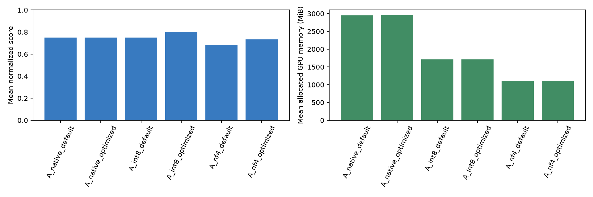
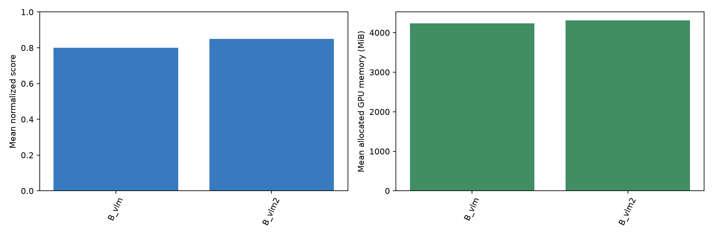
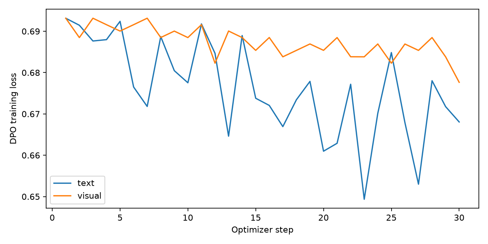
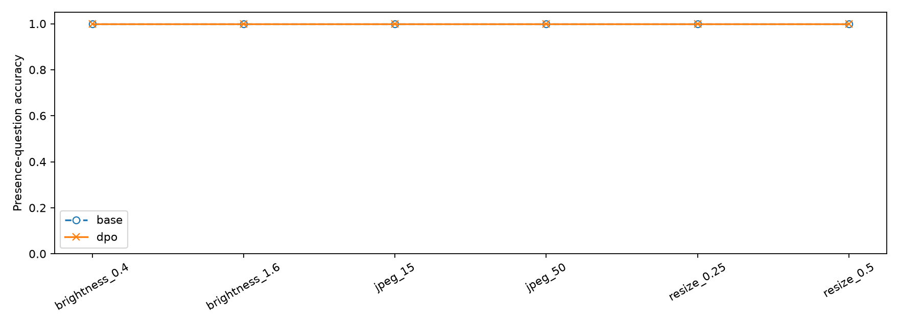

# Week 7 實驗報告

本報告由實際逐題輸出自動產生，未將未執行項目視為完成。所有模型與資料來源、程式均在 main.ipynb。

## 實驗設定

GPU：NVIDIA GeForce RTX 3060。貪婪解碼，batch=1，seed=42，max_new_tokens=96。A/B 重複三次用於時間／顯存，重複輸出不視為獨立新題。C 固定 NF4 比較 adapter 前後。

資料：A/B 各20題；文字／視覺偏好各120 train、20 dev，文字40 test、視覺30 test；另100題通用能力測試。資料是自訂模板及合成幾何圖，不是通用大型基準。偏好由程式依真值產生，未宣稱人工標註。

## A：提示工程、量化與顯存

| run_id | n | rows | score | mean_gpu_mib | peak_gpu_mib | latency_s | tokens_per_s | time_weighted_gpu_mib |
| --- | --- | --- | --- | --- | --- | --- | --- | --- |
| A_native_default | 20 | 60 | 0.7500 | 2954.3872 | 2959.2764 | 0.3449 | 30.2451 | 2955.5855 |
| A_native_optimized | 20 | 60 | 0.7500 | 2954.8527 | 2960.7983 | 0.2494 | 28.8233 | 2955.6872 |
| A_int8_default | 20 | 60 | 0.7500 | 1712.4667 | 1740.1914 | 1.4627 | 4.4141 | 1712.7182 |
| A_int8_optimized | 20 | 60 | 0.8000 | 1713.4324 | 1743.8027 | 1.6496 | 4.2459 | 1713.6766 |
| A_nf4_default | 20 | 60 | 0.6833 | 1109.6963 | 1115.7627 | 0.2581 | 40.4011 | 1110.8681 |
| A_nf4_optimized | 20 | 60 | 0.7333 | 1111.2266 | 1141.4341 | 0.4633 | 19.1103 | 1112.1594 |

score 是各題0–1分等權平均；文字任務包含 exact match、數值、JSON結構、事實覆蓋率，不能解讀成所有題型一致的正確率。mean_gpu_mib 為逐題平均，time_weighted_gpu_mib 為依推論時間加權；peak_gpu_mib 為峰值。50ms採樣只估算平均，峰值另用PyTorch計數器。NVML含其他程序，不能解讀成模型獨占顯存。

### 課堂提示技巧逐一比較（原始精度）

| run_id | n | rows | score | mean_gpu_mib | peak_gpu_mib | latency_s | tokens_per_s | time_weighted_gpu_mib |
| --- | --- | --- | --- | --- | --- | --- | --- | --- |
| A_course_cot | 20 | 20 | 0.7500 | 2953.8205 | 2961.1616 | 0.1056 | 56.7217 | 2954.7961 |
| A_course_emotional | 20 | 20 | 0.7500 | 2954.8818 | 2960.7983 | 0.2457 | 28.0933 | 2955.6850 |
| A_course_english | 20 | 20 | 0.7333 | 2954.3492 | 2958.9819 | 0.2182 | 27.7958 | 2954.8807 |
| A_course_fewshot | 20 | 20 | 0.7500 | 2955.7434 | 2965.6133 | 0.1966 | 27.1178 | 2956.3985 |
| A_course_markdown | 20 | 20 | 0.6667 | 2954.8482 | 2960.6167 | 0.2378 | 27.1276 | 2955.4992 |
| A_course_xml | 20 | 20 | 0.7667 | 2954.9108 | 2961.1616 | 0.2385 | 27.5274 | 2955.6427 |
| A_native_default | 20 | 60 | 0.7500 | 2954.3872 | 2959.2764 | 0.3449 | 30.2451 | 2955.5855 |

default為中文zero-shot；cot為逐步思考但最後只給答案；emotional為情緒激勵；fewshot為少量示例；english為整道題目翻譯成英文且保持答案語言／格式；xml及markdown為對同問題增加結構包裝。除default重複3次外，各技巧對相同20題測試一次，品質分析皆以20個獨立題目計。先用獨立dev選出優化提示，再看test，不依test重選。早期未對齊課程的試跑移至pilot_before_course_alignment，不納入正式結果。

## B：相同問題的雙 VLM 比較

| run_id | n | rows | score | mean_gpu_mib | peak_gpu_mib | latency_s | tokens_per_s | time_weighted_gpu_mib |
| --- | --- | --- | --- | --- | --- | --- | --- | --- |
| B_vlm | 20 | 60 | 0.8000 | 4231.5893 | 4249.5884 | 0.2347 | 15.3361 | 4231.6381 |
| B_vlm2 | 20 | 60 | 0.8500 | 4305.6992 | 4328.8555 | 0.1463 | 20.3771 | 4307.0245 |

兩模型使用同一張336×336原圖、相同英文問題與明訂BF16非量化權重，chat template與內部影像處理由各模型processor決定，SmolVLM停用額外切圖。SmolVLM頂層config標示float32，因此明訂BF16以固定比較精度、符合12GB顯存；此處不宣稱SmolVLM原始config精度就是BF16。類型：shape、count、color、OCR、relation，每類4題。主分數為嚴格答案正確率；分類明細見category_scores.csv；OCR另存CER，計數另存有效數值答案MAE，格式錯誤另算失敗，不能把無效答案排除後的MAE當整體成績。

| run_id | ocr_cer | count_valid | count_total | count_mae |
| --- | --- | --- | --- | --- |
| B_vlm | 0.0000 | 12 | 12 | 0.0000 |
| B_vlm2 | 0.0000 | 9 | 12 | 0.3333 |

## C：DPO 前後比較

| run_id | n | rows | score | mean_gpu_mib | peak_gpu_mib | latency_s | tokens_per_s | time_weighted_gpu_mib |
| --- | --- | --- | --- | --- | --- | --- | --- | --- |
| C_text_base_general | 100 | 100 | 0.5900 | 1109.3663 | 1115.3994 | 0.1244 | 46.6982 | 1109.9741 |
| C_text_base_target | 40 | 40 | 0.8000 | 1109.7460 | 1141.4341 | 0.1366 | 41.6265 | 1110.5976 |
| C_text_dpo_general | 100 | 100 | 0.5800 | 1113.6762 | 1119.5557 | 0.1630 | 36.1065 | 1114.2591 |
| C_text_dpo_target | 40 | 40 | 0.8250 | 1114.5484 | 1145.5903 | 0.1639 | 33.9320 | 1115.1176 |
| C_visual_base_target | 30 | 30 | 1.0000 | 1473.4893 | 1527.4365 | 0.1528 | 13.0906 | 1473.4917 |
| C_visual_dpo_target | 30 | 30 | 1.0000 | 1478.1886 | 1531.5928 | 0.1641 | 12.1949 | 1478.1906 |

DPO 使用相同輸入的 chosen/rejected 偏好對，sigmoid loss、beta=0.1；reference 為停用 adapter 的凍結原始模型。只更新語言層q/v的LoRA，NF4基座不更新，r=8、alpha=16、dropout=0、batch=1、梯度累積4、learning_rate=1e-5、1 epoch；訓練並非改prompt。實際訓練步數、可訓練參數、loss、梯度與adapter變化見 training_config、training_log、first_step及adapter/training_complete.json。

### 實際訓練證據

| kind | steps | train_count | adapter_l1_change | train_loss | dev_loss | dev_preference_accuracy |
| --- | --- | --- | --- | --- | --- | --- |
| text | 30 | 120 | 43.4871 | 0.6762 | 0.6700 | 0.9500 |
| visual | 30 | 120 | 47.7696 | 0.6875 | 0.6848 | 0.9500 |

### 主要觀察

- 正式課堂優化提示相對原始提示的原始精度test分數差為+0.0000；dev選出的提示不保證在held-out test提升。

- NF4＋課堂最佳提示相對原始精度＋原始提示，平均allocated顯存下降62.4%，分數差為-0.0167；需同時衡量節省與品質。

- 雙VLM整體正確率：B_vlm=0.800；B_vlm2=0.850。此排名只適用這20張合成場景。

### 配對差值與不確定性

| task | n | delta | low | high |
| --- | --- | --- | --- | --- |
| text_target | 40 | 0.0250 | 0.0000 | 0.0750 |
| text_general | 100 | -0.0100 | -0.0300 | 0.0000 |
| visual_target | 30 | 0.0000 | 0.0000 | 0.0000 |

delta=微調後減微調前；95%區間為對題目做2000次paired bootstrap。模板衍生題彼此相關，此區間可能過窄；若跨零不可宣稱已證明提升。單次seed的小型作業無法代表全面通用能力。

- text_target：平均分數上升 +0.0250，95%區間 [0.0000, 0.0750]。區間包含0，本次小樣本不足以支持穩定提升或退化。

- text_general：平均分數下降 -0.0100，95%區間 [-0.0300, 0.0000]。區間包含0，本次小樣本不足以支持穩定提升或退化。

- visual_target：平均分數未改變 +0.0000，95%區間 [0.0000, 0.0000]。區間包含0，本次小樣本不足以支持穩定提升或退化。

### 目標能力診斷

| task | supported_accuracy | unknown_accuracy | over_refusal | false_positive_rate | false_negative_rate | invalid_rate | absent_n | present_n |
| --- | --- | --- | --- | --- | --- | --- | --- | --- |
| text_base | 0.6190 | 1.0000 | 0.0000 | — | — | — | — | — |
| visual_base | — | — | — | 0.0000 | 0.0000 | 0.0000 | 10.0000 | 20.0000 |
| text_dpo | 0.6667 | 1.0000 | 0.0000 | — | — | — | — | — |
| visual_dpo | — | — | — | 0.0000 | 0.0000 | 0.0000 | 10.0000 | 20.0000 |

視覺 false_positive_rate 僅指不存在形狀卻回答 yes；invalid_rate 另列，避免格式錯誤被當成無幻覺。文字以答案正確率、UNKNOWN正確率及過度拒答率分開評估。

## C 進階：影像劣化

| run_id | n | rows | score | mean_gpu_mib | peak_gpu_mib | latency_s | tokens_per_s | time_weighted_gpu_mib |
| --- | --- | --- | --- | --- | --- | --- | --- | --- |
| C_visual_base_brightness_0.4 | 30 | 30 | 1.0000 | 1473.4573 | 1527.4365 | 0.1539 | 12.9963 | 1473.4524 |
| C_visual_base_brightness_1.6 | 30 | 30 | 1.0000 | 1473.9210 | 1527.4365 | 0.1550 | 12.9272 | 1473.9261 |
| C_visual_base_jpeg_15 | 30 | 30 | 1.0000 | 1473.9349 | 1527.4365 | 0.1549 | 12.9156 | 1473.9265 |
| C_visual_base_jpeg_50 | 30 | 30 | 1.0000 | 1473.3687 | 1527.4365 | 0.1566 | 12.7806 | 1473.3629 |
| C_visual_base_resize_0.25 | 30 | 30 | 1.0000 | 1474.7607 | 1527.4365 | 0.2203 | 9.0800 | 1474.7511 |
| C_visual_base_resize_0.5 | 30 | 30 | 1.0000 | 1473.9316 | 1527.4365 | 0.2190 | 9.1362 | 1473.9377 |
| C_visual_dpo_brightness_0.4 | 30 | 30 | 1.0000 | 1479.0267 | 1531.5928 | 0.2477 | 8.0767 | 1479.0359 |
| C_visual_dpo_brightness_1.6 | 30 | 30 | 1.0000 | 1477.9872 | 1531.5928 | 0.2482 | 8.0606 | 1477.9938 |
| C_visual_dpo_jpeg_15 | 30 | 30 | 1.0000 | 1478.4889 | 1531.5928 | 0.2464 | 8.1189 | 1478.4839 |
| C_visual_dpo_jpeg_50 | 30 | 30 | 1.0000 | 1478.3135 | 1531.5928 | 0.2462 | 8.1232 | 1478.3191 |
| C_visual_dpo_resize_0.25 | 30 | 30 | 1.0000 | 1479.1291 | 1531.5928 | 0.2481 | 8.0651 | 1479.1277 |
| C_visual_dpo_resize_0.5 | 30 | 30 | 1.0000 | 1478.4092 | 1531.5928 | 0.2533 | 7.9042 | 1478.4558 |

每次只改一種因素：亮度0.4／1.6，JPEG品質15／50，縮小到0.25／0.5再放回原尺寸。原圖為C視覺target對照。每個條件使用相同30張held-out圖片，原始／DPO模型的精度、prompt相同。標籤沿用幾何真值，需人工確認嚴重劣化後形狀仍可辨認。

本次六種劣化條件的平均正確率完全相同，未觀察到此範圍內的畫質／明暗影響；不能推論更嚴重劣化或真實照片也完全不受影響。

## 商用 LLM／VLM 評審

| run_id | n | correctness | instruction_following |
| --- | --- | --- | --- |
| A_int8_default | 20 | 3.0500 | 3.6500 |
| A_int8_optimized | 20 | 3.4500 | 3.7000 |
| A_native_default | 20 | 3.0500 | 3.5000 |
| A_native_optimized | 20 | 3.4000 | 3.7000 |
| A_nf4_default | 20 | 3.3000 | 3.3500 |
| A_nf4_optimized | 20 | 3.3000 | 3.4500 |
| B_vlm | 20 | 3.8000 | 3.7000 |
| B_vlm2 | 20 | 3.6000 | 3.9000 |

評審來源與版本、理由及時間見commercial_judge_scores.jsonl。每條件預期20題；未滿20題屬部分評估。相同題目與完全相同輸出共用同一次語意檢視的評分；160代表逐條件評分紀錄數，不代表160次外部API呼叫。本次Codex對話評審屬同一工作階段的商用模型評估，精確部署ID未取得，非獨立API雙盲實驗，不應以此單獨證明模型優劣。

### 規則分數與語意評審的差異

- JSON內容正確但外加Markdown圍欄：內容分數可高，格式分數低，嚴格JSON測試判失敗。

- H₂O與H2O化學意義相同，字面exact match可能誤判；商用評審依語意判斷。

- 摘要即使包含週一、9點及17點等關鍵詞，仍可能在其他句子聲稱週一開放；事實覆蓋率不等同整段內容完全正確，需保留原始答案與逐題理由。

- 視覺形狀答案用完整句子時，辨識內容與只輸出一個單字的指令遵循可有不同評分。不能將嚴格輸出分數單獨當視覺能力結論。

本次B的排名依指標而翻轉：嚴格答案分數以B_vlm2較高，商用評審的內容正確性以B_vlm較高。差異主要來自Qwen在三道形狀題多寫句子，以及SmolVLM在一題計數答錯；因此應把視覺內容與輸出格式分開討論。

## 限制與可重現性

- 提示技巧依課程清單實作CoT指令、情緒激勵、Few-Shot、中英文、XML及Markdown；CoT只要求最後答案，不能驗證模型內部是否真正採用逐步推理。

- 合成場景只測顏色、幾何、空間、OCR與存在性，未測真實照片、開放世界物件偵測或自然圖片描述。

- 文字資料是120筆模板衍生偏好，數量符合最低要求，但多樣性有限；模型可能已很擅長任務而出現天花板效果。

- 機器有其他GPU程序，顯存主指標採本程序PyTorch allocated；時間可能受競爭影響。NF4量化只涵蓋支援層，不是所有計算／KV cache都4-bit。

- model_revisions.json、data_manifest.json、environment.json、逐題JSONL與training logs保留實際版本及證據。所有成效結論以本報告實測表格為準，負向或零改善結果同樣保留。
